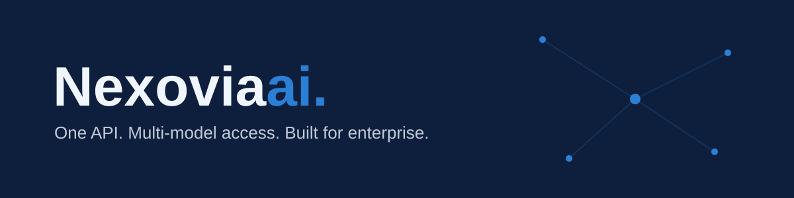

  

## Nexoviaai — unified AI API aggregation platform

Nexoviaai gives engineering teams **one API, one key and one bill** for multi-model AI access, with routing, usage controls and enterprise billing built in.

- **One integration** — switch models by changing a single parameter, not your codebase
- **Usage & cost control** — per-key limits, usage visibility and predictable pricing
- **Enterprise-ready** — regional entity, DPA, AUP and SLA available, invoicing in your currency
- **Bring your own key (BYOK)** — use existing provider agreements through the same gateway

### Get started

| | |
|---|---|
| 🚀 **Quickstart** | [nexoviaai/quickstart](https://github.com/nexoviaai/quickstart) — copy-paste examples in Python, Node and curl |
| 🔑 **Request early access** | [nexoviaai.com](https://nexoviaai.com/?utm_source=github&utm_medium=org_profile&utm_campaign=early_access) |
| 🖥️ **Live demo** | [demo.nexoviaai.com](https://demo.nexoviaai.com/?utm_source=github&utm_medium=org_profile) |
| 🤝 **Partnerships** | partners@nexoviaai.com |
| 🛡️ **Security** | security@nexoviaai.com |

---
Nexoviaai Technology Sdn. Bhd. · Early access now open for regional enterprise teams.
